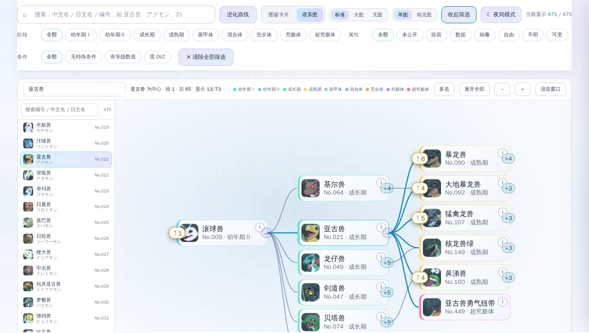
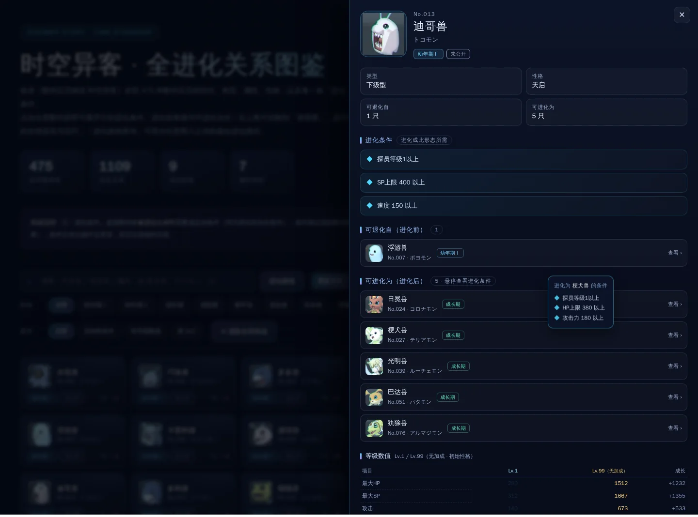

# 数码宝贝物语 时空异客 · 全进化关系图鉴

《Digimon Story: Time Stranger》475 只数码兽的离线图鉴与谱系图，单个 `index.html` 即可运行，无构建、无依赖、可离线打开。

**在线预览 / Live demo**：https://kazuko2012.github.io/digimon-time-stranger-guide/

An offline field guide and evolution-graph explorer for all 475 Digimon in *Digimon Story: Time Stranger*. Everything runs from a single `index.html` — no build step, no runtime dependencies.

## 多语言 / Languages

顶部工具栏可切换 **中文 / English / 日本語**（桌面在右侧按钮组，手机在工具栏第二行靠左），并记忆上次选择、支持深链 `?lang=en` / `?lang=ja`。
名称、简介与全部界面术语（阶段、属性、类型、性格、条件、技能数值、耐性）均本地化；英文与日文名称、简介取自 [digimon.net](https://digimon.net/) 官方图鉴。


## 预览 / Screenshots

**图鉴卡片视图**：475 只全列表，顶部三组筛选（阶段 / 属性 / 条件）与「标准 / 无图」密度切换 + 卡片大小步进器。


**谱系图视图**：以亚古兽为中心，左侧窄栏 475 只可切换，节点左 `↑N` 上溯、右 `+N` 下展，连线为进化关系（无箭头）。  



**详情抽屉**：基础数值、Lv99 数值、耐性与技能、图鉴说明；「可进化为」列表里鼠标悬停任一条目，即显示进化成该形态所需的条件。



---

## 功能 / Features

**图鉴卡片 / Card view**

- 475 只数码兽，编号、中文名、日文名、阶段、属性、进化条件
- 图片密度两档：标准 / 无图；卡片大小五档步进器；图片加载方式两种：单图按需 / 精灵图切片
- 阶段、属性、条件三组筛选，可叠加；一键清除全部筛选
- 点击卡片打开详情抽屉：基础数值、Lv99 数值、属性抗性、技能、进化条件、图鉴说明

**谱系图 / Lineage view**

- 以任意一只为中心，逐层展开后代与祖先，可无限上溯
- 节点左侧金色 `↑N` = 还没显示的直系进化源数量，点击往上拉出一层
- 节点右侧蓝色 `+N` = 还没显示的直系下一代数量，点击往下展开一层
- 滚轮缩放（锚定光标位置）、拖拽平移、双击空白适应窗口、`适应窗口` 按钮
- 悬停高亮「该节点 → 中心」的整条链，弱化无关分支
- 折叠逐步展开，展开/收起保持当前视角不跳
- 进化路线查询：任选两只，算出最短进化链与同长度备选路线
- 瀑布大纲：按世代列出本谱系全部节点（含折叠分支），点条目自动展开路径并居中
- 鹰眼缩略图：右下角 220×150 全谱系缩略图，白框标中心、青框标当前视口，点击/拖动快速平移
- 多选：同时选中多只，比较各自的进化路线
- 左栏可一键收起 / 展开，画布占满；谱系内筛选为浮层，回卡片页自动恢复

**通用 / Common**

- 详情侧栏可左右拖动调宽（双击回到半屏），顶部一键「半屏 / 全屏」，宽度与状态会被记住
- 深浅双主题，选择会被记住
- 搜索支持中文名 / 日文名 / 编号（编号自动三位补零）
- 记忆上次状态：视图、中心、搜索词、筛选组合
- 深链：地址栏自动带 `?view=lineage&d=092&q=暴龙`，可直接分享某个谱系
- 键盘：`/` 聚焦搜索，`← →` 切换相邻编号，`L` 谱系图，`C` 图鉴卡片，`F` 适应窗口，`Esc` 关闭浮层
- 无障碍：焦点环、`aria-label`、`prefers-reduced-motion` 时关闭动效
- 移动端：谱系页左栏收起为左下角「› 展开列表」全屏抽屉（475 只可滚动筛选），单指拖动平移、双指缩放；工具栏紧凑排布
- GitHub 入口：工具栏最右侧「GitHub ↗」按钮（新窗口打开本仓库），卡片页页脚另有文字链接

## 目录结构 / Layout

```
.
├── index.html                # 主页面（唯一运行文件）
├── assets
│   ├── icons/                # 475 张图标，001.webp … 475.webp，112×112
│   └── sprites/              # 精灵图：sprite-56 / 112 / 160.webp
├── data
│   ├── digimon-475.csv       # 词条数据（编号 / 名称 / 阶段 / 属性 / 条件 / 说明）
│   └── digimon-lv99.csv      # 各性格 Lv99 数值
├── scripts
│   └── build_single.py       # 打成一个自包含的离线单文件版
├── docs                     # README 用真实截图
│   ├── screenshot-deck.webp
│   ├── screenshot-lineage.webp
│   └── screenshot-drawer.webp
└── .github/workflows/pages.yml   # 推 main 自动发布到 GitHub Pages
```

## 本地运行 / Run locally

```bash
# 直接双击 index.html 也行；用本地服务更稳妥（避免个别浏览器对本地图片的限制）
python3 -m http.server 8000
# 打开 http://localhost:8000
```

## 打包单文件版 / Build a standalone file

```bash
python3 scripts/build_single.py
# 产出 dist/digimon-time-stranger-guide-single.html（图标 base64 内嵌，约 2.9 MB）
```

单文件版可以拷到 U 盘或直接发给别人，断网、无服务器也能打开。

## 部署 / Deploy

推到 `main` 分支后，GitHub Actions 会把这个仓库发布到 GitHub Pages：

`https://kazuko2012.github.io/digimon-time-stranger-guide/`

仓库设置里把 **Settings → Pages → Source** 选为 **GitHub Actions** 即可。

## 更新说明 / Changelog

### v1.9.10 — 2026-11-21 · 谱系中心光圈随阶段配色

- 去掉中心节点上方的「中心」文字标签，改由描边与光晕表达
- 中心节点的 2px 内环、5px 外环、26px 光晕全部取该兽的**成长阶段色**：幼年期青、成长期绿、成熟期琥珀、完全体橙、究极体紫、超究极体粉、装甲体浅蓝、混合体蓝紫，与节点左侧色条、徽章同色
- 中心与普通节点的区别仍靠「双环 + 更亮光晕 + 更高层级」，不依赖文字

## 数据来源 / Data

- 数值与图鉴说明整理自日版攻略站 AppMedia 的《时空异客》图鉴页（含 DLC 数码兽）
- 进化条件文本做了中文意译，与游戏内原文可能有措辞差异，以游戏内为准
- 图标来自游戏内素材，仅作同人图鉴用途

## 声明 / Disclaimer

本项目是非商业性质的同人整理作品。《数码宝贝》系列角色、名称、图像版权归 Bandai Namco Entertainment 及各自权利方所有。代码部分以 MIT 许可开源，素材版权不随代码许可转让。若权利方有异议，会立即下线相关内容。

This is a non-commercial fan project. All Digimon characters, names and artwork belong to Bandai Namco Entertainment and their respective owners. The source code is released under MIT; the license does **not** extend to third-party game assets.

## 许可 / License

代码：MIT（见 `LICENSE`）。素材：版权归原权利方，仅限学习交流。
